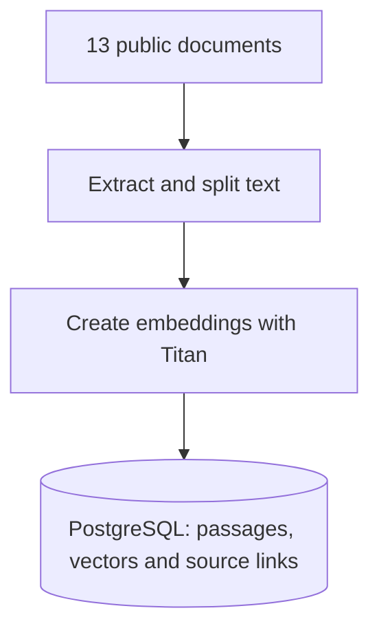
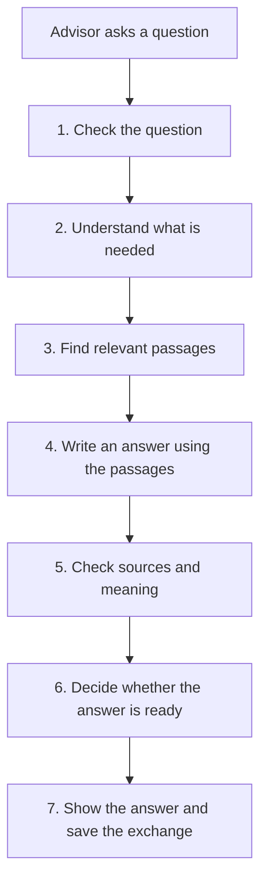

# Sightbridge Advisor Intelligence

**A research assistant for financial advisors, built around sources they can check.**

[Try the live app](https://main.d4rzdcojhvk3v.amplifyapp.com) · [One page business memo](docs/memo.pdf) · [Technical overview](docs/technical.md)

Advisor and admin reviewer credentials are shared privately.

## The problem and the solution

Financial advisors need clear explanations of 1031 exchanges, Delaware Statutory Trusts (DSTs) and 721 exchanges. The rules are spread across long tax and investment documents, and small details such as deadlines and exceptions matter.

The assistant searches **13 selected public sources** and explains what it finds in everyday language. Each supported statement includes a citation to the document passage. It declines personalized investment recommendations, avoids questions outside its knowledge, and keeps an audit record that an admin can inspect.

For example, an advisor can ask **“What is a DST?”**, follow with **“Explain that more simply”**, and then ask **“Which source supports that?”** without starting over.

## How it works

Documents are prepared in advance. The application extracts their text, divides it into **284 passages**, and stores each passage with its source details and a searchable representation of its meaning in PostgreSQL. The original files are retained in S3.

When an advisor sends a question, the assistant follows seven simple steps. Some questions take a shorter route. For example, an obvious request for personal investment advice is declined immediately, without calling an AI model.

| Step | What happens in simple words |
| --- | --- |
| **1. Check the question** | Basic rules recognize requests the assistant should not answer, such as personal investment recommendations. Those receive a polite response immediately. |
| **2. Understand what is needed** | For most questions, AI reads the recent conversation to work out what to search for. Very clear questions and simple requests, such as asking which source was used, skip this step. |
| **3. Find relevant passages** | The system searches the approved documents for information that can support an answer. It can reuse earlier evidence when someone asks for a simpler explanation. |
| **4. Write the answer** | AI explains the findings in plain language and points to the passages it used. |
| **5. Check the answer** | Python confirms the quoted passages exist. A second AI checks whether the explanation agrees with the evidence. |
| **6. Decide what to show** | Python can accept the answer, remove a weak sentence, ask for one rewrite, or say that the answer could not be confirmed. |
| **7. Show and save** | The user sees the answer with clickable sources and a disclaimer. The exchange is recorded for admin review. |

The steps are coordinated by ordinary Python code, not independent AI agents. They help the assistant provide traceable answers without pretending that every AI response is guaranteed correct. The [technical overview](docs/technical.md) shows the full routing and verification flow.

## What you can try

| Ask the assistant | Expected behavior |
| --- | --- |
| “What is a 1031 exchange?” | Explains the concept using cited sources |
| “What about the other deadline?” (after asking about the 45-day deadline) | Uses the conversation to work out which deadline is meant |
| “Which source supports that?” | Shows previously saved sources without a new AI call |
| “Which DST should I buy?” | Declines personalized investment advice immediately |
| “What is today's best performing REIT?” | Does not invent live market data |

## Testing and limitations

The reported evaluation covered **24 individual questions**, with the expected outcome on **24 of 24**, and **10 of 10 turns** in the safety and advice conversations. The tests include citations, insufficient evidence and refusals. These are small, known test sets, not a guarantee that all future answers will be correct.

## What's left out and what's next

Left out to keep the project within scope:

- Sightbridge's own documents, such as offering memorandums and FAQs. The library uses public sources only.
- Live data, such as current offerings, yields or fees, and any personalized recommendations.
- Single sign-on, private database networking (the database uses a public endpoint protected by encrypted connections and credentials) and automatic backend deployment, which the current AWS account setup blocks.

What I would build next:

1. Larger evaluations reviewed by people, including questions the assistant has not seen.
2. A compliance-approved document workflow: upload, sign-off, versioning and scheduled refresh.
3. Private networking, a durable job queue, monitoring and single sign-on for advisors.

## Approved sources

| Source | Publisher | Main subject |
| --- | --- | --- |
| [Like-kind exchanges – Real estate tax tips](https://www.irs.gov/businesses/small-businesses-self-employed/like-kind-exchanges-real-estate-tax-tips) | IRS | 1031 |
| [Like-kind exchanges now limited to real property](https://www.irs.gov/newsroom/like-kind-exchanges-now-limited-to-real-property) | IRS | 1031 |
| [Instructions for Form 8824, Like-Kind Exchanges](https://www.irs.gov/instructions/i8824) | IRS | 1031 |
| [Revenue Ruling 2004-86](https://home.treasury.gov/system/files/136/archive-documents/rr0486.pdf) | IRS (copy hosted by U.S. Treasury) | DST and 1031 |
| [26 U.S.C. § 1031](https://www.law.cornell.edu/uscode/text/26/1031) | Cornell LII | 1031 |
| [26 CFR § 1.1031(k)-1](https://www.law.cornell.edu/cfr/text/26/1.1031%28k%29-1) | Cornell LII | 1031 |
| [26 U.S.C. § 721](https://www.law.cornell.edu/uscode/text/26/721) | Cornell LII | 721 |
| [721 Exchange/UPREIT](https://www.franklintempleton.com/forms-literature/download/721-FL) | Franklin Templeton | 721 and REIT |
| [Real Estate Investment Trusts (REITs)](https://www.investor.gov/introduction-investing/investing-basics/investment-products/real-estate-investment-trusts-reits) | SEC Investor.gov | REIT |
| [Private Placements under Regulation D](https://www.investor.gov/introduction-investing/general-resources/news-alerts/alerts-bulletins/investor-bulletins/private-placements-under-regulation-d-updated-investor-bulletin) | SEC Investor.gov | Investment risks |
| [Accredited Investors](https://www.investor.gov/introduction-investing/investing-basics/glossary/accredited-investors) | SEC Investor.gov | Investor education |
| [Notice to Members 05-18](https://www.finra.org/rules-guidance/notices/05-18) | FINRA (then NASD) | 1031 and TIC interests |
| [Six Risks of Delaware Statutory Trusts in 1031 Exchanges](https://www.kiplinger.com/retirement/risks-of-delaware-statutory-trusts-in-1031-exchanges) | Kiplinger | DST risks |

We deliberately excluded an older IRS fact sheet that predates the change limiting Section 1031 exchanges to real property.

## For developers

See [Technical overview](docs/technical.md) for the architecture, model workflow, audit controls, tests, deployment instructions and local setup. The business recommendation is in [the memo](docs/memo.md) ([PDF](docs/memo.pdf)).
