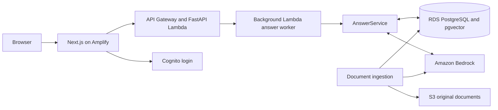
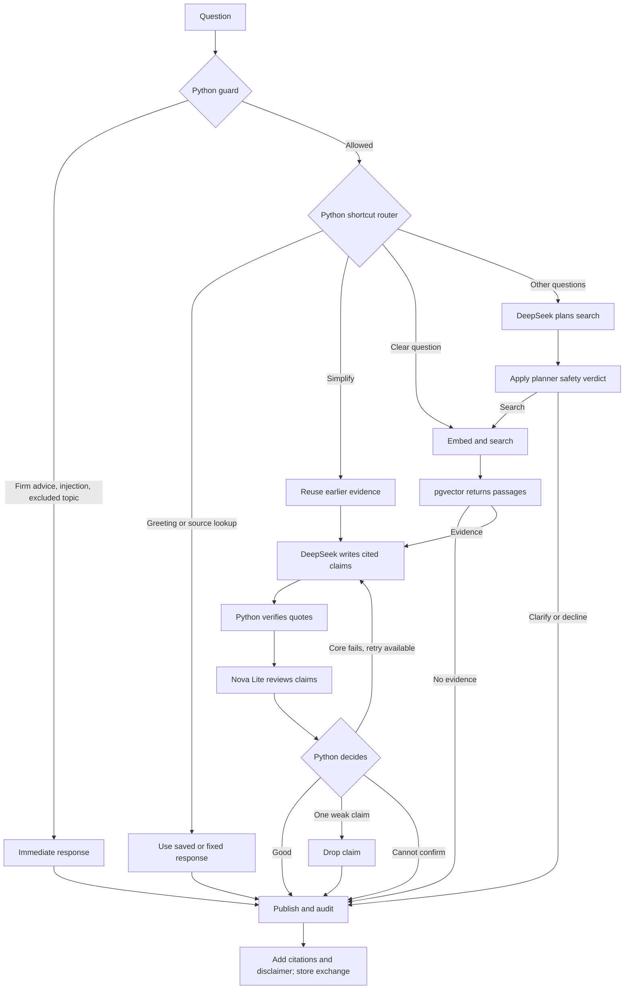

# Technical overview

This document is for reviewers who want to understand the implementation. The [README](../README.md) explains the product and user experience; this page focuses on system behavior, engineering choices and how to run it.

## Architecture

The application uses **Next.js 15** on AWS Amplify, **FastAPI with Python 3.12** on AWS Lambda behind API Gateway, and **PostgreSQL 16 with pgvector** on RDS. Cognito manages invite only login and admin groups. Amazon Bedrock provides DeepSeek V3.2 for planning and writing, Nova Lite for review and fallback, and Titan Text Embeddings V2 for similarity search. Terraform manages resources in `ap-southeast-2` (Sydney).



The backend separates `api/` (HTTP and identity), `application/` (use cases and orchestration), `domain/` (models and Python policies), and `infrastructure/` (database, Bedrock and other adapters). `AnswerService` in `backend/app/application/rag/service.py` controls the pipeline. **There is no LangGraph.** LangChain helps with Bedrock model calls and structured responses, rather than controlling the workflow.

## Source ingestion

`python -m scripts.ingest` reads the 13 source definitions, downloads each public PDF or web page, extracts text with page or section references, and splits it into passages. The recorded corpus has **284 chunks**, generally around 1,200 characters with 200 characters of overlap, respecting section and page boundaries.

Titan turns each chunk into a **1,024 dimensional vector**. The application stores that vector, the original chunk text and the source URL in PostgreSQL; S3 retains original files. Content hashes prevent unchanged documents from being ingested again. `ingestion_runs` tracks results. Question answering uses the chunks in PostgreSQL, so it does not read PDFs from S3 for each question.

## Request and answer flow

The diagram below expands the seven stages in the README. It shows the actual branches for immediate refusals, saved evidence, planning, verification and one possible rewrite. These are steps coordinated by `AnswerService`, not LangGraph nodes.

Next.js forwards authenticated requests through a server side proxy. FastAPI verifies the Cognito token and user permissions, applies rate limits, and runs the initial guard. Allowed questions requiring model work return a job ID while a second invocation of the same Lambda processes the answer. The browser polls for progress and the result. Immediate refusals are answered directly without a background job. Fixed replies, such as source lookups, still use the job but make no model call.



### What each step does

| Step | Implementation and responsibility |
| --- | --- |
| **Guard** | Python patterns recognize firm personalized advice requests, prompt injection, sensitive input and excluded topics. Such requests receive a fixed response immediately. General educational questions, including lawful tax deferral and reporting rules, can proceed. |
| **Shortcut router** | Python conditions handle greetings, reuse saved citations, reuse evidence for simplification and skip planning for clear questions. |
| **Planner** | DeepSeek handles every question the shortcut router does not settle. It reads up to four recent conversation turns, checks request safety and creates up to three self contained searches. Nova Lite is a fallback. |
| **Retriever** | Titan embeds each search query. pgvector compares it with document vectors, returning up to six relevant passages with a configured similarity floor of `0.40`. Returned passages contain text and source metadata. |
| **Writer** | DeepSeek generates structured explanation claims and key points. Each claim includes a retrieved passage ID and verbatim supporting quote. Nova Lite can act as backup writer. |
| **Quote checker** | Python verifies that the cited passage was retrieved, the quotation is a substring of its stored text after normalization, the claim overlaps its evidence and the claim lacks prohibited personal advice wording. This establishes traceability, not factual truth. |
| **Reviewer** | Nova Lite checks evidence consistency, conditions and safety. If the planner already screened the request, it reviews only the answer; otherwise it also reviews the request. |
| **Decide** | Python publishes accepted claims, drops one weak claim when the main answer remains useful, asks the writer for one rewrite if the core fails, or returns an unconfirmed answer. It does not make an AI call itself, but can trigger another writer call. |
| **Publish and audit** | Python numbers the citations, builds source links, adds the disclaimer, and saves the answer and its sources. No model call is needed. |

The quote checker uses the **complete passage text already returned from PostgreSQL**, not another vector lookup. It verifies the model's short quotation with a normalized text containment check. The citation link comes from metadata stored alongside that passage. A real quote can still support an incorrect interpretation; the reviewer and later human evaluation reduce, but cannot eliminate, that risk.

## Cost, reliability and audit

The application avoids model calls for fixed replies, source lookups and firm refusals. Clear questions skip planning. Simplification reuses previously cited passages. A question requiring interpretation usually uses **three language model calls** (plan, write, review); a clear factual question usually uses **two**, plus a Titan embedding call for new retrieval. Retry and fallback calls happen only when needed.

The worker has a **60 second shared model budget** with per step limits. It does not start a rewrite without adequate remaining time. Requests, retrieved evidence, and output tokens are bounded. Model tokens and estimated cost are recorded with the exchange. A recorded comparison across seven multi turn conversations found **53 language model calls over 29 turns**, compared with 78 in an earlier configuration, and approximately **$0.08 versus $0.11** in estimated model cost. Those results describe a limited benchmark, not future billing guarantees.

PostgreSQL holds `documents`, `document_chunks`, `ingestion_runs`, `users`, `conversations`, `exchanges`, and `answer_activity`. Every completed exchange records its question, rendered answer, citation snapshot, outcome, timestamp and model usage. A trigger blocks ordinary updates and deletes to `exchanges`, making it an append only audit trail. The admin view is restricted to Cognito `admin` group members; advisors can access only their own conversations.

## Security and operational boundaries

Cognito tokens are verified by the API for signature, issuer, audience, expiry and use. Next.js keeps sessions in HTTP only cookies and proxies allowed backend requests. Authorization is enforced in FastAPI rather than trusting the browser. Database credentials and Bedrock configuration are stored in SSM SecureString; the encrypted S3 Terraform state bucket must also be protected because it contains infrastructure secrets. CloudWatch records structured request logs.

Application limits include **six questions per minute**, **60 per hour**, **two active requests per user**, and **four active requests overall** due on free tier plan. The database currently has a public endpoint protected by authentication and TLS. This keeps the demo infrastructure simple but is **not the intended network design for financial production data**. The background worker uses asynchronous Lambda invocation rather than a durable queue.

## Testing

The automated suite covers policy decisions, citations, conversation ownership, authentication attacks, request limits, database behavior, model failures and the pipeline's AI call counts. Browser tests exercise the main desktop and mobile flows. GitHub Actions checks lint, typing, builds, tests and Terraform configuration.

The recorded real model evaluation contains **24 individual questions with 24 expected outcomes**, plus **10 of 10 turns passing** in the focused safety and advice conversations. Nine longer conversation journeys exercise follow ups and cost behavior. Since the tests are small and known to the development process, they do not prove performance on unseen questions. A prior journey run included an embedding timeout; a bounded retry is now implemented.

```bash
cd backend
uv run pytest
uv run ruff check
uv run ruff format --check
uv run mypy app tests scripts
uv run python -m scripts.run_eval --worker-budget --label <name>
uv run python -m scripts.run_journeys --label <name>
```

For frontend browser tests, run `cd frontend && npm run test:e2e`.

## Local development

From the repository root, start PostgreSQL and configure local settings:

```bash
docker compose up -d
cp .env.example backend/.env
# Set LOCAL_AUTH_SECRET in backend/.env
cd backend
uv sync
uv run alembic upgrade head
uv run python -m scripts.ingest
uv run uvicorn app.main:app --port 8080
```

In a second terminal:

```bash
cd frontend
cp ../.env.example .env.local
npm install
npm run dev
```

Open `http://localhost:3000` with a configured `LOCAL_DEMO_USERS` account. Local development uses stand ins for live model calls; production evaluation requires Bedrock access. Never commit secrets or reviewer passwords.

## Deployment and known limits

Terraform provisions AWS resources in Sydney (`ap-southeast-2`). The operator builds the Lambda package, reviews `terraform plan`, applies the configuration, then runs Alembic migrations, ingestion and Cognito reviewer setup. Configuration examples are under `infra/terraform/`.

```bash
cd backend && ./scripts/build_lambda.sh
cd ../infra/terraform
terraform init -backend-config=backend.hcl
terraform plan -out=deployment.tfplan
terraform apply deployment.tfplan
```

The backend is deployed manually because the current AWS account setup blocks the selected GitHub deployment integration. CI verifies that the live backend matches the intended revision before the Amplify frontend release and smoke tests. AWS budget alerts notify at configured thresholds but **do not cap spending**.

The corpus is a fixed snapshot, conversation context is bounded, and an AI reviewer can still miss errors. Before a wider rollout, the priorities are independent human reviewed evaluations, refreshed and compliance approved source documents, private database networking, durable job delivery and monitoring. These are future work, not current capabilities.
